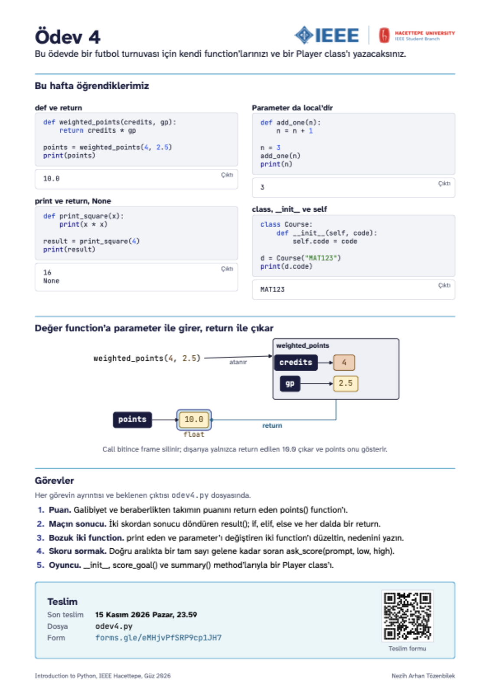
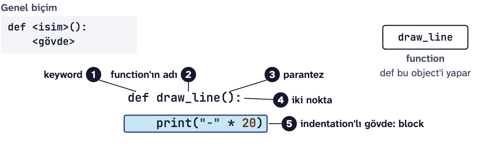
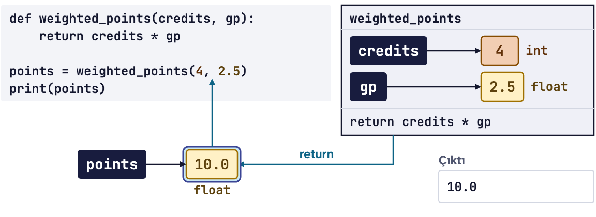
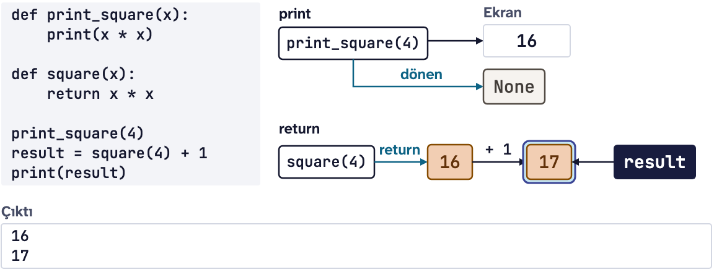
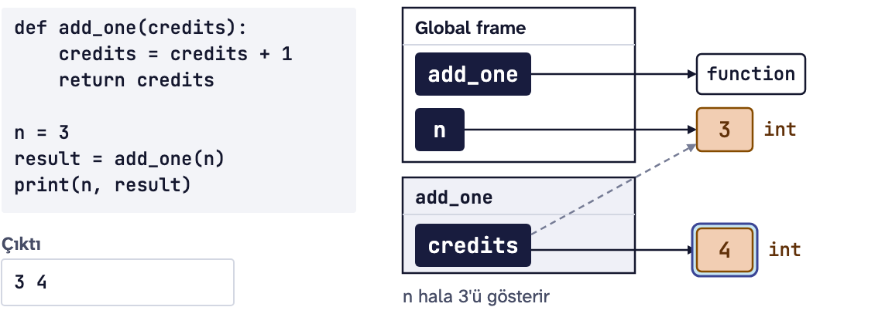
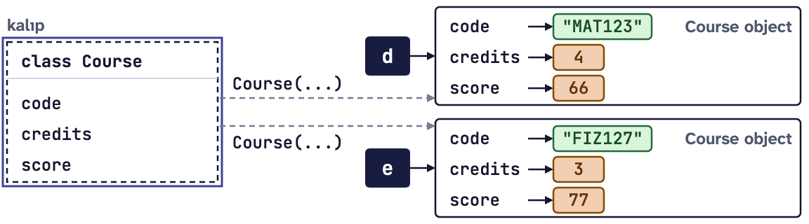

# Ödev 4: Fakülteler arası futbol turnuvası

IEEE Hacettepe **Introduction to Python** dersinin 4. ödevi, Güz 2026.

Bu ödevin sonunda kendi function'larınızı (fonksiyon) yazıp onlardan değer alabilecek, print ile return'ü ayırabilecek, hatalı girdide yeniden soran bir function ve kendi class'ınızı (sınıf) yazabileceksiniz.

Bu haftanın ana cümlesi: **değer function'a parameter ile girer, return ile çıkar.** Bölümlerin çoğu bu cümlenin bir parçasını gösteriyor. Her bölümün sonunda ödevin hangi görevinde işinize yarayacağı yazıyor; bazılarında kendinizi deneyebileceğiniz kısa bir soru da var. Cevabı açmadan önce kendiniz tahmin edin.

<p align="center"></p>

Yukarıdaki kart bu haftanın özeti. Aşağıda aynı konuların daha ayrıntılı tekrarı var.

**İndirmek için:** yeşil **Code** düğmesine basın, **Download ZIP** deyin, zip'i açın. Git bilmenize gerek yok.

**Son teslim:** 15 Kasım 2026 Pazar, 23.59\
**Teslim:** [Ödev 4 teslim formu](https://forms.gle/eMHjvPfSRP9cp1JH7)


## Bu ödevde kullanacaklarımız

Hepsini Ders 4'te gördük. 4. görevde gereken Ders 3 konusunu en sona ekledim.

### import ve module
Module (modül), başkasının yazıp denediği kodu tutan bir dosyadır. `import` onu programa getirir; içindeki bir isme nokta ile ulaşırız.

```python
import math
print(math.sqrt(16))
```

```text
4.0
```

`random.randint(1, 6)` 1 ile 6 arasında bir tam sayı verir; `range()`'in tersine iki uç da gelebilir:

```python
import random
die = random.randint(1, 6)
print(die >= 1 and die <= 6)
```

```text
True
```

**Ödevde:** Meraklısına görevindeki penaltı atışları `random.randint` ile yazılıyor.

### def, call ve parameter
Function, isim verilmiş ve çağrılınca çalışan bir kod block'udur. `def` yalnızca tanımlar; block'u call (çağrı) çalıştırır. Bir kez yazılan function'ı istediğiniz kadar çağırabilirsiniz: kantinde tarif kartı bir kez asılır, "bir tost" siparişi her gün verilir. Call'da parantezin içine yazılan değere argument denir; parameter (parametre), call anında argument'ın atandığı isimdir.



```python
def say_hello(name):
    print(f"Selam {name}")

say_hello("millet")
say_hello("Yusuf")
```

```text
Selam millet
Selam Yusuf
```

Birden çok parameter varsa argument'lar onlara sırayla atanır.

**Sık yapılan hatalar:** argument'ı unutmak, yani `say_hello()` yazmak:

```text
TypeError: say_hello() missing 1 required positional argument: 'name'
```

ve function'ı `def` satırından önce çağırmak. Python yukarıdan aşağı okur; call satırı çalışırken isim henüz yoktur:

```text
NameError: name 'say_hello' is not defined
```

**Ödevde:** her görev bir `def` satırıyla başlıyor; satırlar hazır, block'u siz yazıyorsunuz.

### Return value (dönüş değeri)
`return`, bir değeri call'un yapıldığı yere geri gönderir. Aşağıda `gp` (grade point) dersin katsayısı. Call bitince yerine dönen değer geçer: aşağıdaki satır sanki `points = 10.0` yazılmış gibi devam eder.



```python
def weighted_points(credits, gp):
    return credits * gp

points = weighted_points(4, 2.5)
print(points)
```

```text
10.0
```

Değer yazabildiğiniz her yere call da yazabilirsiniz: bir expression'ın içine ya da bir if'in şartına.

```python
def has_passed(gp):
    return gp >= 1.75

if has_passed(2.5):
    print("geçti")
```

```text
geçti
```

Bir function'da birden çok return olabilir; hangisi önce çalışırsa function orada biter. if, elif ve else'in her dalına bir return yazmak bu yüzden sık kullanılır.

**Sık yapılan hata:** bir dala return yazmayı unutmak. O dal çalışınca function hata vermez, `None` döndürür.

**Ödevde:** 1. görevin `points()`'i bir hesap return ediyor, 2. görevin `result()`'ı her dalında bir str return ediyor.

<details>
<summary><b>Kendinizi deneyin:</b> aşağıdaki kod ne yazdırır?</summary>

```python
def half(n):
    return n / 2

print(half(10) + 1)
```

```text
6.0
```

`half(10)` 5.0 döndürür (`/` her zaman float verir); call'un yerine 5.0 geçer ve 1 eklenir.

</details>

### İç içe call
Bir call'un sonucu başka bir call'un argument'ı olabilir. Önce içteki çalışır; dönen değer dıştakine gider. `print(len("Ali"))` satırını Ders 2'den biliyorsunuz: önce `len` 3 döndürür, sonra `print` onu yazar. Kendi function'larınızda da sıra aynı:

```python
def twice(n):
    return n * 2

def plus_one(n):
    return n + 1

print(twice(plus_one(3)))
print(plus_one(twice(3)))
```

```text
8
7
```

İlk satırda önce `plus_one(3)` 4 döndürür, sonra `twice(4)` 8. İkinci satırda sıra ters: aynı iki function, başka sonuç.

Bir function başka bir function'ı kendi block'unun içinden de çağırabilir. İşin bir parçasını ona bırakır ve dönen değeri kendi hesabında kullanır:

```python
def grade_point(score):
    if score >= 50:
        return 2.5
    else:
        return 0.0

def course_points(credits, score):
    return credits * grade_point(score)

print(course_points(4, 66))
print(course_points(3, 40))
```

```text
10.0
0.0
```

Katsayı kuralı tek bir yerde, `grade_point`'te yazılı; değişirse yalnızca orası değişir.

**Ödevde:** `odev4.py`'deki `print("Mühendislik:", points(4, 1))` satırı da bir iç içe call: önce sizin `points`'iniz çalışır, dönen 13'ü `print` yazar. `points` return etmezse print'e `None` gider.

<details>
<summary><b>Kendinizi deneyin:</b> <code>print(plus_one(plus_one(1)))</code> ne yazdırır?</summary>

`3`. İçteki `plus_one(1)` 2 döndürür, dıştaki `plus_one(2)` 3.

</details>

### print ve return, None
print değeri ekrana yazar; return programa geri verir. `print_square(4)` ile `print(square(4))` ekranda aynı 16'yı gösterir; fark, değeri sonra kullanmak istediğinizde çıkar. return yazılmayan bir function `None` döndürür: "bir değer yok" demektir.



```python
def print_square(x):
    print(x * x)

def square(x):
    return x * x

x = print_square(4)
print(x)
print(square(4) + 1)
```

```text
16
None
17
```

**Sık yapılan hata:** print eden bir function'ın sonucuyla hesap yapmak, örneğin `print(print_square(4) + 1)`. Önce 16 yazılır, sonra:

```text
TypeError: unsupported operand type(s) for +: 'NoneType' and 'int'
```

Bir function hesaplar ve return eder; ana program print eder.

**Ödevde:** 3. görevin ilk bozuk function'ı da return etmek yerine print ediyor. Düzeltmeden çalıştırırsanız hata almazsınız; 5'in altında "Gol farkı: None" görürsünüz.

<details>
<summary><b>Kendinizi deneyin:</b> aşağıdaki kod ne yazdırır?</summary>

```python
def double(n):
    print(n * 2)

x = double(5)
print(x)
```

```text
10
None
```

`double` 10'u ekrana yazar ama return etmez; `x`'e `None` bağlanır ve ikinci satırda o yazılır.

</details>

### Local variable ve scope
Function'ın içinde oluşan isim, local variable (yerel değişken), yalnızca call sürerken vardır; call bitince kaybolur. Bir ismin kullanılabildiği yere o ismin scope'u (kapsam) denir. Parameter da local'dir: ona yeni bir değer atamak dışarıdaki ismi değiştirmez.



```python
def add_one(credits):
    credits = credits + 1
    return credits

n = 3
result = add_one(n)
print(n, result)
```

```text
3 4
```

`n` hala 3: bir isme yaptığınız değişiklik function'ın dışına yalnızca return ile çıkar. Değer function'a parameter ile girer, return ile çıkar.

Dışarıdaki bir ismi function'ın içinden okumak serbesttir; yukarıdaki `course_points` `grade_point`'i bu sayede buluyor. Ama içeride bir isme assignment yaparsanız Python yeni, local bir isim açar ve dışarıdakine dokunmaz.


**Sık yapılan hata:** function'ın içindeki ismi dışarıda kullanmak:

```python
def make_local():
    local = 5

make_local()
print(local)
```

```text
NameError: name 'local' is not defined. Did you mean: 'locals'?
```

`local` yalnızca call sürerken vardı. Python'un önerdiği `locals` başka bir şey, ona bakmayın.

**Ödevde:** 3. görevin ikinci bozuk function'ı parameter'a yeni değer atayıp dışarıdakinin değişmesini bekliyor.

<details>
<summary><b>Kendinizi deneyin:</b> aşağıdaki kod ne yazdırır?</summary>

```python
def reset(total):
    total = 0

total = 7
reset(total)
print(total)
```

```text
7
```

`reset`'in içindeki `total` call'un kendi ismi; ona 0 atamak dışarıdaki `total`'a dokunmaz.

</details>

### class ve object
class (sınıf), aynı yapıdaki object'lerin (nesne) kalıbıdır. `__init__`, object yapılırken kendiliğinden çalışan method'dur; `self` o anda yapılan object'tir. `self.code = code` gibi satırlar object'in içine attribute (özellik) koyar.



```python
class Course:
    def __init__(self, code, credits, score):
        self.code = code
        self.credits = credits
        self.score = score

d = Course("MAT123", 4, 66)
e = Course("FIZ127", 3, 77)
print(d.code, d.credits, e.code, e.credits)
```

```text
MAT123 4 FIZ127 3
```

Her `Course(...)` call'u yeni bir object yapar ve her object'in attribute'ları kendisine aittir.

**Sık yapılan hata:** `__init__`'te `self.` yazmamak. `code = code` yalnızca local bir isimdir ve `__init__` bitince kaybolur; object boş kalır ve `print(d.code)` şunu verir:

```text
AttributeError: 'Course' object has no attribute 'code'
```

**Ödevde:** 5. görevin `__init__`'i de böyle kurulur: `name` ve `number`'ı self'e yazar, `goals`'ı 0'dan başlatır.

### Class içinde method
Method, class'ın içinde yazılan ve ilk parameter'ı `self` olan function'dır. Bir method object'i değiştirebilir ya da bir değer döndürebilir. Çağırırken `self`'i yazmayız; noktanın solundaki object'i Python verir.

```python
class PiggyBank:
    def __init__(self):
        self.money = 0

    def deposit(self, amount):
        self.money += amount

    def show(self):
        return f"Kumbarada {self.money} TL"

k = PiggyBank()
k.deposit(100)
k.deposit(50)
print(k.show())
```

```text
Kumbarada 150 TL
```

`deposit` hiçbir şey return etmiyor ama değişiklik kalıyor: yeni bir isim açmıyor, `self`'in gösterdiği object'in attribute'una yazıyor. Değer yine parameter ile giriyor (`amount`).

**Sık yapılan hata:** method'un tanımında `self`'i unutmak (`def show():`):

```text
TypeError: PiggyBank.show() takes 0 positional arguments but 1 was given
```

**Ödevde:** 5. görevin `Player`'ı da `PiggyBank` gibi kurulur: `__init__` attribute'ları koyar, `score_goal()` object'i değiştirir, `summary()` bir str return eder.

<details>
<summary><b>Kendinizi deneyin:</b> aşağıdaki kod ne yazdırır?</summary>

```python
class Counter:
    def __init__(self):
        self.count = 0

    def add(self):
        self.count += 1

a = Counter()
b = Counter()
a.add()
a.add()
b.add()
print(a.count, b.count)
```

```text
2 1
```

`a` ile `b` ayrı object'ler; her birinin `count`'u kendisine ait.

</details>

### Ders 3'ten: while True, try ve except
`int()`, sayıya çevrilemeyen bir yazıda ValueError verir. try ve except bu hatayı yakalar; while True ile birlikte doğru girdi gelene kadar yeniden sorar. Function'ın içinde break yerine return loop'u da function'ı da bitirir:

```python
def ask_int(prompt):
    while True:
        try:
            number = int(input(prompt))
            return number
        except ValueError:
            print("Tam sayı girin.")

credits = ask_int("Kredi: ")
print(credits * 2)
```

```text
Kredi: üç
Tam sayı girin.
Kredi: 3
6
```

Burada da ana cümle geçerli: soru metni (`prompt`) parameter ile girer, sayı return ile çıkar.

**Ödevde:** 4. görevin `ask_score()`'u bunun kardeşi; tek fark, sayı aralığın dışındaysa da yeniden sorması.

## Görevler

Görevlerin ayrıntısı ve her birinin beklenen çıktısı `odev4.py` dosyasının içinde.

1. **Puan:** Galibiyet ve beraberlik sayısından takımın puanını return eden `points(wins, draws)` function'ını yazacaksınız.
2. **Maçın sonucu:** İki takımın golünden "ev sahibi kazandı", "deplasman kazandı" ya da "berabere" döndüren `result(home, away)` function'ını if, elif ve else ile, her dalda bir return ile yazacaksınız.
3. **Bozuk iki function:** Hata vermeden yanlış sonuç veren iki function'ı düzelteceksiniz: biri sonucu return etmek yerine print ediyor, öbürü parameter'ı değiştirip değişikliğin dışarı çıkmasını bekliyor. Her birine nedenini tek cümleyle yazacaksınız.
4. **Skoru sormak:** Doğru aralıkta bir tam sayı gelene kadar soran `ask_score(prompt, low, high)` function'ını while True, try ve except ile yazacaksınız.
5. **Oyuncu:** Adı, forma numarasını ve golünü tutan, `score_goal()` ile golü artıran ve `summary()` ile "Arda (10): 2 gol" döndüren bir `Player` class'ı yazacaksınız.

Zorunlu olmayan bir **Meraklısına** görevi de var: import random ile penaltı atışlarını yazacaksınız; eşitlik bozulana kadar penaltılar sürecek.

Yalnızca Ders 1, 2, 3 ve 4'te gördüğümüz yapıları kullanın.

## Nasıl çalışılır

1. Zip'ten çıkan `odev4.py` ve `kontrol.py` dosyalarını aynı klasörde tutun ve `odev4.py`'yi PyCharm'da açın.
2. Her görevde `# TODO` satırının yerine kodunuzu yazın. Function'ların ve class'ın ilk satırları hazır; gövdedeki `pass`'i silip kendi satırlarınızı yazın.
3. Dosyayı **Run** ile çalıştırın ve çıktıyı görevin "Beklenen çıktı" kısmıyla karşılaştırın. Henüz yazmadığınız function'lar `None` döndürür; çıktıda None görmenizin nedeni bu.

4. görevde program sizden sayı ister: Run penceresine sırayla üç, 25 ve 3 yazın, her birinden sonra Enter'a basın.

## Kendi kendinize kontrol

Bitirince `kontrol.py`'yi PyCharm'da açıp **Run** deyin. Her görev için geçti ya da kaldı yazar, kaldıysa beklenen satırı ve sizin satırınızı gösterir. Görevin istediği yapıyı, örneğin return'ü, elif'i, try ve except'i ya da self'i kullanıp kullanmadığınıza da bakar. 1, 2, 4 ve 5. görevlerde bir call'u değiştirip dosyayı bir kez daha çalıştırır; sonucu elle yazdıysanız bunu fark eder. 4. görevin sorularına üç, 25 ve 3'ü kendisi yazar. Dosya 10 saniyede bitmezse durdurur ve hangi görevde takıldığını söyler. Kontrol not vermez, sadece size yol gösterir. Beşi de geçtiyse değeri parameter ile alıp return ile veren function'lar ve kendi class'ınızı yazabiliyorsunuz demektir.

## Teslim

[Ödev 4 teslim formunda](https://forms.gle/eMHjvPfSRP9cp1JH7) "İsim" alanına isminizi yazın, `odev4.py`'yi "Ödev dosyası" alanına yükleyin ve "Kişisel verileriniz" sorusundaki onay kutusunu işaretleyin. Söylemek istediğiniz bir şey varsa isteğe bağlı "Açıklama" alanına yazabilirsiniz.

Takıldığınız bir yer olursa dersin WhatsApp grubuna yazın.

Dersin sitesi: https://natozenbilek.github.io/ieee-hacettepe-python-course/
